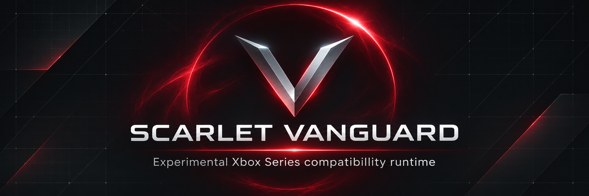
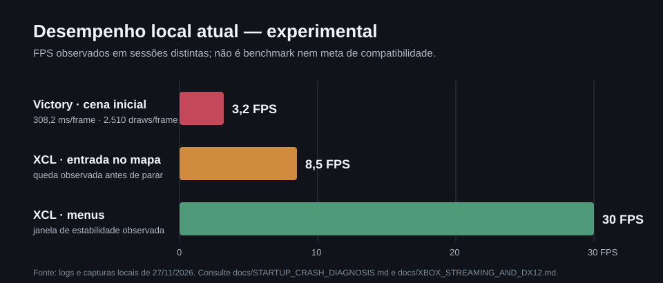

# Scarlet Vanguard

> **Experimental Xbox Series compatibility runtime for Windows x64**



Scarlet Vanguard is an open-source research superproject for studying how Xbox
Series workloads can be hosted on Windows x64. It brings independent loader,
HLE, shader-translation, D3D12, Vulkan, diagnostics and launcher research into
one repository with a shared build and publication policy.

> [!WARNING]
> This is experimental compatibility research, not an official product or a
> production emulator. Correctness, performance and title support are
> incomplete. Use only with software you are authorized to access; the project
> neither ships game files nor provides DRM circumvention.

## Current development status

| Area | Status | Notes |
| --- | --- | --- |
| Windows x64 toolchain | Validated | Rust/MSVC, native x64 loader paths and the WinForms launcher build locally. |
| XDK/HLE surface | In progress | Core process, input, storage and graphics interfaces are implemented incrementally. |
| D3D12/DXIL path | Experimental | Shader and pipeline preparation are available, but unsupported GPU paths remain. |
| NVIDIA runtime profile | Experimental | Conservative 8 GB profile: NVIDIA selection, on-demand levels and staged texture uploads. |
| Shader warm-up | Available | Offline translation and observed-pipeline warm-up report their progress. |
| Ray tracing / water lighting | Disabled by safe profile | Kept off until stable, measured runs exist. |
| Game compatibility | Per-title | No compatibility or performance guarantee. |

### Development priorities

- [x] One Git root and one validation/build surface for all runtime research.
- [x] Product launcher with configurable game-folder selection and readable logs.
- [x] Offline shader translation and cache/pipeline warm-up workflow.
- [ ] Eliminate incomplete D3D12 pipeline/command-list paths.
- [ ] Reduce texture residency churn and frame-time spikes during streaming.
- [ ] Establish repeatable PIX/ETW frame-time captures for every supported path.
- [ ] Promote only measured, reproducible compatibility results.

## Performance snapshot



These values are local observations from separate sessions on 27 November
2026—not a benchmark and not directly comparable between runtimes. The Victory
scene is currently dominated by texture residency and incomplete translation;
the XCL menu result does not represent map or gameplay stability. See
[startup diagnosis](docs/STARTUP_CRASH_DIAGNOSIS.md) and
[streaming notes](docs/XBOX_STREAMING_AND_DX12.md) for the raw context.

## Architecture

```text
Xbox Series title
       |
       +-- HLE / loader / XDK surface emulation
       |
       +-- Shader translation and pipeline cache
       |
       +-- DirectStorage-style asset streaming
       v
Windows x64 + D3D12/DXGI or Vulkan + vendor driver
```

Scarlet Vanguard is a single Git superproject—not a group of submodules. The
source units share the root tooling and retain their original license material.

| Directory | Responsibility |
| --- | --- |
| `src/xcl/` | D3D12.X / DXIL compatibility-layer research |
| `src/victory/` | NVIDIA-oriented runtime, streaming and pipeline experiments |
| `src/leonida/` | Vulkan-oriented research path and analysis tools |
| `scripts/` | Build, validation, measurement and launch workflows |
| `assets/` | Scarlet Vanguard branding and project-owned visual assets |
| `configs/` | Hardware profiles |
| `docs/` | Architecture notes, evidence and runbooks |

## Quick start

Requirements: Windows x64, Rust/MSVC and a legally obtained title stored
outside this repository.

```powershell
./scripts/validate.ps1 -Strict
./scripts/build.ps1 -Component victory

# Offline cache preparation. Run only while victory.exe is closed.
./scripts/victory-nvidia.ps1 -GameExe 'D:\Games\Title\game_scarlett_master.exe' -Preload

# Launch with the conservative NVIDIA profile.
./scripts/victory-nvidia.ps1 -GameExe 'D:\Games\Title\game_scarlett_master.exe'
```

The launcher is built with `./scripts/build-launcher.ps1`. It displays the
Scarlet Vanguard banner by default and prefers a logo, splash or cover image
found in the selected game folder when one is available.

## Open source and attribution

Scarlet Vanguard is open source. The root repository is intentionally free of
game executables, game assets, extracted shaders, caches, logs and downloaded
SDKs. Contributions must preserve that rule and must retain upstream copyright
and license notices.

This project consolidates and adapts research from the following upstream
projects. They deserve direct credit for their foundations:

- [XCL](https://github.com/xcl-dev/xcl) — Xbox Series X|S-to-Windows
  compatibility-layer research; its attribution and license are retained in
  [`src/xcl/`](src/xcl/).
- [VIctory](https://github.com/Marvisak/VIctory) — original runtime foundation.
- [VIctory-NVIDIA](https://github.com/trustno1-coder/VIctory-NVIDIA) by
  trustno1-coder — NVIDIA-oriented base used by the consolidated Victory path.
- [victory-fork](https://github.com/fxceless/victory-fork) by fxceless —
  additional runtime, shader and diagnostics work incorporated during this
  project’s consolidation.
- The Leonida source tree and its third-party components — notices and licenses
  remain in [`src/leonida/`](src/leonida/).

The inclusion of a source unit does not change its upstream license. Before
redistributing a derivative or a binary, review the license files in each
`src/*` directory.

## Repository policy

- Do not commit games, keys, packages, extracted content, caches or captures.
- Keep reproducible source and scripts in Git; regenerate build output locally.
- Record hardware, driver, settings and methodology with every performance
  claim.
- Label upstream figures as upstream and local results as local observations.
- Report defects with logs stripped of private paths and proprietary content.

## Documentation

- [Runtime source map](src/README.md)
- [Xbox streaming and D3D12](docs/XBOX_STREAMING_AND_DX12.md)
- [Performance runbook](docs/PERF_RUNBOOK.md)
- [Startup crash diagnosis](docs/STARTUP_CRASH_DIAGNOSIS.md)
- [Platform abstraction](docs/PLATFORM_ABSTRACTION.md)
