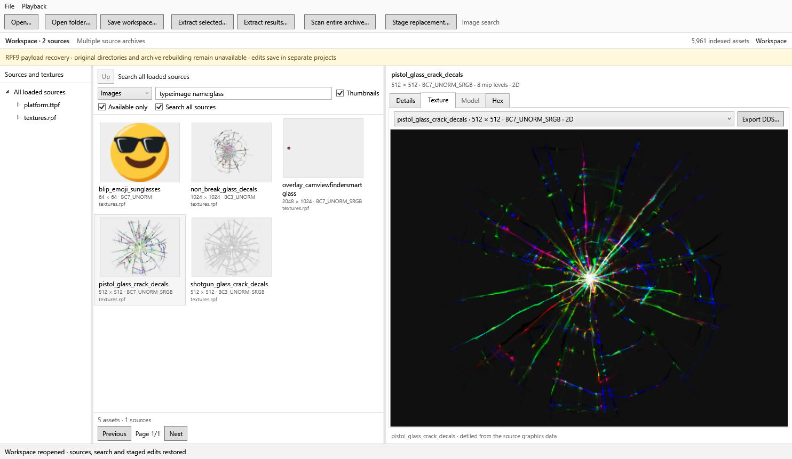
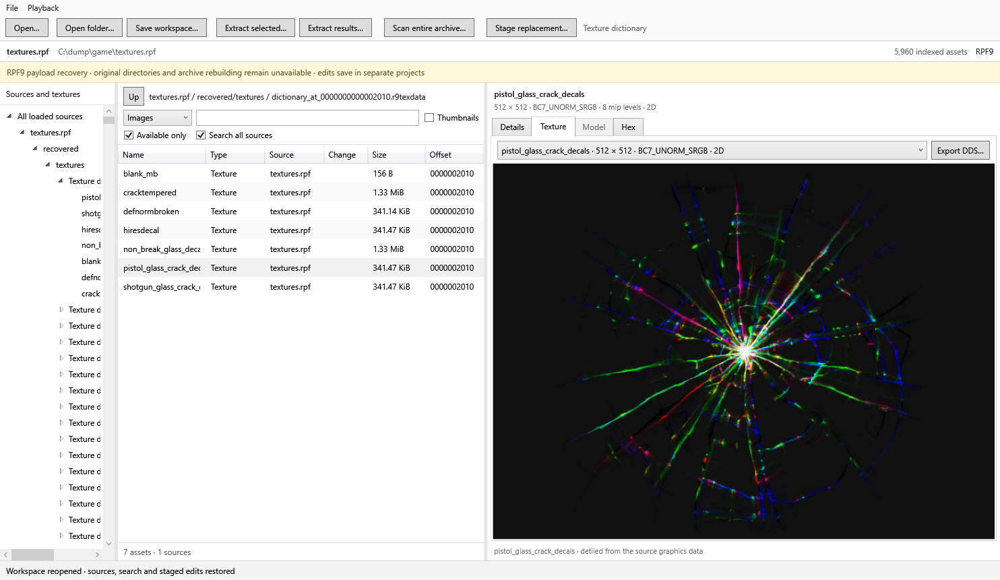
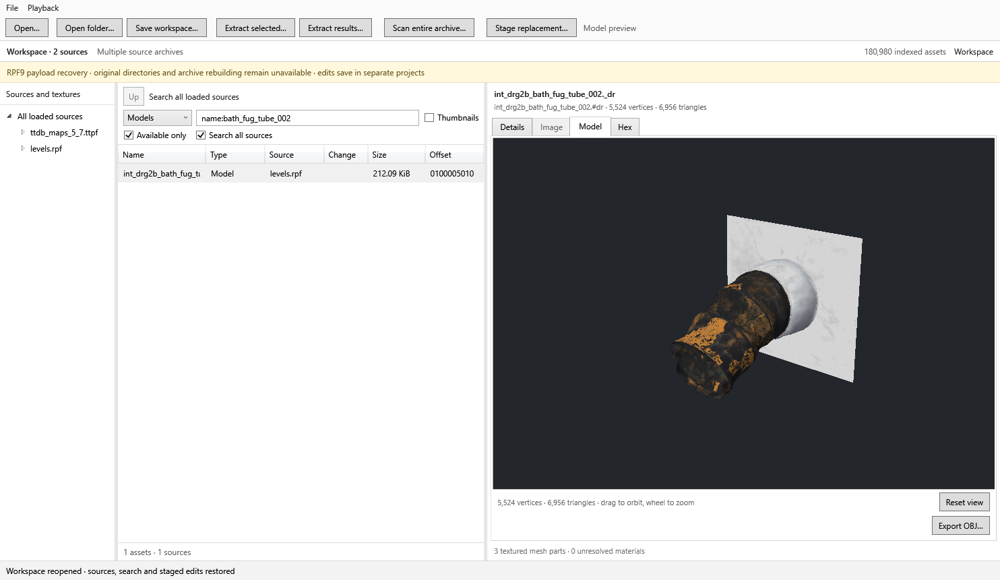
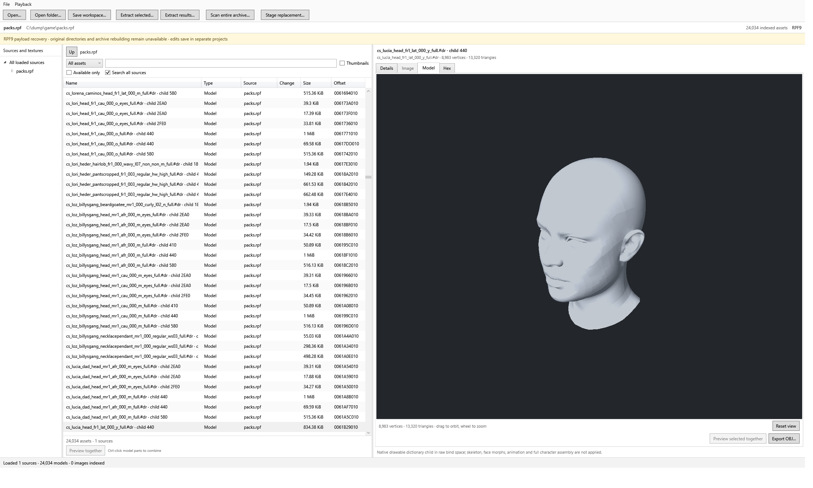
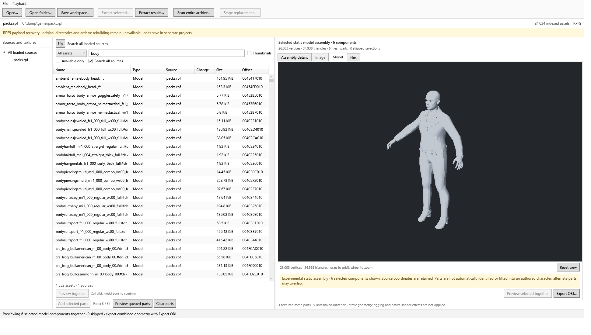
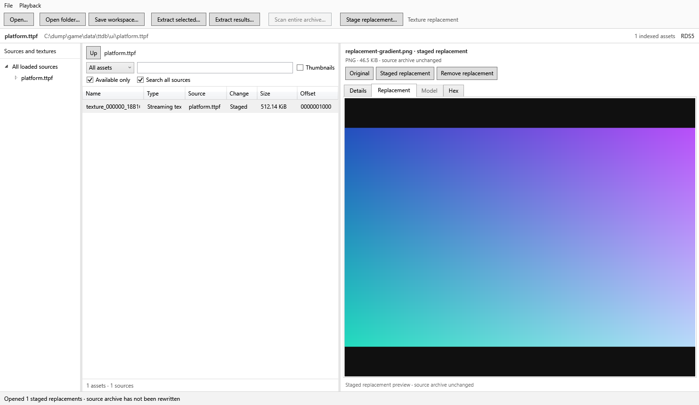

# rpf9-explorer 1.2

A Windows desktop viewer for RPF archives and game assets. Open multiple archives or a folder, search textures, preview models and media, export files, and save replacement projects.

RPF9 support is partial. The original archive directory is not decoded, and the app cannot rebuild a complete RPF9 archive. Model texture support is still being improved.

## About GTA 6

This is an unofficial project developed while inspecting RPF9 files associated with GTA 6. **The source contains no actual GTA 6 game code.** GTA 6 source code, decompiled game code, game executables, and game scripts are not included.

The source package contains the explorer's code, build files, documentation, and third-party notices. Game archives and raw model, texture, audio, and movie files are not bundled. The screenshots show the app displaying files loaded locally.

This project is not affiliated with, endorsed by, or sponsored by Rockstar Games or Take-Two Interactive. GTA 6 and related names belong to their respective owners.

## Open files or a folder

Extract the Windows build ZIP and run `rpf9-explorer.exe`. Keep the `Tools` and `Licenses` folders beside it.

- Click **Open** or press **Ctrl+O** to select one or more `.rpf`, `.ttpf`, or `.zip` files.
- Click **Open folder** to find supported files in a folder and its subfolders.
- You can also drag files or a folder into the window.

Opening more files adds them to the current workspace. Use **File > Clear loaded sources** to start over. A workspace can hold up to 512 source files.

Select a source or folder on the left to browse it. Model discovery now checks the entire RPF9 file on first open, including drawable dictionaries that contain character components. Older model indexes are refreshed automatically, while validated earlier models are retained. Progress is shown and discovery can be canceled. Large archives can take a while on the first pass; later opens use the saved index. **Scan entire archive** also searches other supported payload types. These scans do not decode the original archive directory.

## Find and preview textures

Choose **Images** in the filter above the file list. Turn on **Thumbnails** to browse image previews, then select an image to see it on the right. Thumbnail pages contain up to 96 images.



Searches match all the words you enter. Use quotes for a phrase, `-word` to exclude a word, and `*` or `?` for wildcards. Search is case-insensitive.

| Search | Result |
| --- | --- |
| `type:image name:glass` | Images with glass in their name |
| `format:bc7 width:>=1024` | BC7 images at least 1024 pixels wide |
| `source:textures -normal` | Matches in texture sources, excluding normal |
| `size:<2MiB height:>=512` | Files smaller than 2 MiB and at least 512 pixels high |

Other fields are `archive:`, `key:`, `hash:`, `mips:`, `w:`, and `h:`. Numeric fields accept `>`, `>=`, `<`, `<=`, and `=`. Size values accept `KiB`, `MiB`, and `GiB`.

**Search all sources** searches every loaded file while a query is entered. Uncheck it to search the current location. **Available only** hides entries that cannot be extracted with the current decoders. Selecting a folder in the tree clears the search.

### Browse a texture dictionary

Expand an archive and its folders under **Sources and textures**, then expand a texture dictionary to see its images. You can also double-click a **Texture folder** row. Use **Up** to return to its parent.



The texture selector above the preview switches between images in the same dictionary. Arrays, cube maps, and volumes also have a slice or face selector where supported. **Export DDS** saves the texture in DDS format, including the available mip levels.

Supported TTPF layouts include compact 2D mip chains, 2D arrays, streaming cube maps, and single-mip 3D volumes, including Xbox BCPack BC1, BC3, BC4, and BC5 chunks. The preview can select individual slices or faces, and DDS exports preserve the supported texture shape. R16G16B16A16_UNORM previews retain the original 16-bit channels in DDS exports. Unvalidated storage profiles, unsupported formats, and unsupported BCPack codecs (BC6H/BC7) remain unavailable. These additional layouts and BCPack-compressed textures are read-only; they do not add native replacement support.

Streaming textures may have generated names based on native keys. These are not claimed to be their original filenames.

## Preview models

Choose **Models**, search for a model, and select it. The preview loads supported geometry and matches diffuse textures by their native asset keys. It checks embedded model textures, loaded texture sources, and sibling game texture folders when available.



Drag with the left mouse button to orbit, drag with the right mouse button to pan, and use the mouse wheel to zoom. **Reset view** resets the camera. **Export OBJ** saves decoded geometry and supported UV coordinates.

Character parts inside drawable dictionaries appear as individual model results using their native names. Searching `lucia` can find explicitly named Lucia parts, while shared body parts and player components may have names such as `hand_fr1`, `feet_fr1`, or `player_story000_00`. Free-text searches for `body`, `arms` or `legs` also include the shared skin components. These names do not by themselves identify an authored character or outfit. Different detail variants may share a name; source offsets distinguish them.

Use **Add selected parts** to collect model components across different searches. **Preview queued parts** overlays the collected components in their original coordinates and keeps their supported texture bindings. **Clear parts** empties the queue. You can also Ctrl- or Shift-select two or more visible rows and click **Preview together**. **Export OBJ** saves the combined geometry. **Assembly details** lists every component, omitted selection, source and material mapping. This is a static component preview. It does not select missing body parts, infer character identity, apply body morphs, or reproduce animation. Alternate clothes and detail variants can overlap.





Load the relevant texture pools if a model appears gray. The text below the preview reports missing materials, lower-resolution mip levels, and layered-material approximations. Layered materials show the first available supported color layer. Some distant models use their native vertex colors when they have no UV coordinates.

Model recovery also supports fragments with absent optional header pointers, supported 16-bit bone-palette declarations, larger validated geometry lists, and zero-radius drawables. Empty declared bounds use the decoded geometry for the preview. These changes do not add animation or rigged export.

Use **Scan entire archive** to rebuild a saved model index after a decoder update. Model recovery supports RPF9 resources with small uncompressed metadata or geometry tails alongside their zlib blocks.

Some models still have missing or unsupported material bindings, even when the pools are loaded. Unsupported Xbox BCPack codecs (BC6H/BC7) remain unavailable. Full game shaders, palette effects, animation, and skeleton transforms are not reproduced.

## Play movies and audio

Select a supported movie or audio bank to open its preview. Audio banks have a stream selector. Playback controls include play, pause, seek, loop, and volume. Movie previews also have frame stepping and full screen.

Native game audio and Bink movie previews need the corresponding helpers in `Tools`. These helpers are included in the Windows build, but their executables are not included in the source ZIP. Some audio codecs remain unsupported, and decoded audio previews are limited to 120 seconds. For 32 kHz AWC Opus streams, the preview and its saved WAV use the bank's playback rate.

## Extract files

Select results and click **Extract selected**. Use Ctrl or Shift to select multiple rows or thumbnails. **Extract results** exports available entries in the current filtered results.

Exports are grouped into separate source folders. Existing files are not overwritten. Texture image entries export as DDS files. Recovered model entries now export their selected geometry as OBJ, including the correct drawable dictionary child. Texture dictionary payloads use the app's `.r9texdata` format. **Export OBJ** also saves the current model or static assembly.

Extraction exports the original assets. Staged replacements are stored separately in the workspace.

## Save edits and reopen a workspace

1. Select an asset and click **Stage replacement**.
2. Choose the replacement file. Models accept OBJ, textures accept DDS/PNG/JPEG, and audio streams accept WAV.
3. If prompted, choose where to save the workspace.
4. Use **Original** and **Staged replacement** to compare them. **Remove replacement** removes the project override.



Imports and removals save automatically. **Save workspace** or **Ctrl+S** also saves the source list, search, folder, and selection. Open it again with **File > Open workspace**.

Keep the `.rpfworkspace` file and its `.rpfworkspace.assets` folder together. Keep the source files at their saved paths. A workspace does not contain a backup of the archives. Older `.rpfproject` files can still be opened.

Matching staged texture edits are used when previewing a model. **They are not written into the original RPF9 archive.** Full RPF9 write-back remains unavailable. The experimental pool-copy export supports certain compatible DDS replacements in RDS5 pools; in-game compatibility is unverified.

## Build from source

Install the .NET 10 SDK on Windows. Run these commands from the source folder:

```powershell
dotnet build App/RpfPreview.App.csproj -c Release
powershell -ExecutionPolicy Bypass -File ./build.ps1
```

The publish script creates `dist/rpf9-explorer.exe` as a self-contained Windows x64 build. NuGet restores the pinned dependencies.

### Optional media helpers

`Tools/BinkPreview.cpp`, `Tools/BinkPlayer.cpp`, and `Tools/OpusPreview.cpp` contain the helper source. Their `Build-*.ps1` scripts require Visual C++ and the Windows SDK. Adjust the compiler and SDK paths in those scripts for your installation.

Bink requires a separately installed licensed Unreal Bink SDK. Opus requires libopus headers and a library. Those external SDKs are not included. Build the helpers before running `build.ps1` to copy them into the published `Tools` folder. For XMA2 audio, put a compatible `ffmpeg.exe` in `Tools` before publishing.

The Windows 1.2 build uses libopus 1.6.1. To use your own static libopus build, pass `-OpusRoot` (the folder containing `include/opus.h`) and `-OpusLibrary` (the x64 `/MT` static library) to `Tools/Build-OpusPreview.ps1`. Compiler and Windows SDK paths can also be supplied as parameters.

Model and texture browsing do not need the media helpers.

## Source layout

| Folder | Contents |
| --- | --- |
| `App` | WPF interface and preview sessions |
| `Core` | Archive readers, decoders, search, extraction, and edit projects |
| `Tools` | Native helper source, build scripts, and the indexing CLI |
| `docs/screenshots` | Screenshots used in this README |

## Third-party notice

AMD addrlib-derived address patterns and mip layout:
Copyright (c) 2007-2024 Advanced Micro Devices, Inc. All Rights Reserved.
Permission is hereby granted, free of charge, to any person obtaining a copy
of this software and associated documentation files (the "Software"), to deal
in the Software without restriction, including without limitation the rights
to use, copy, modify, merge, publish, distribute, sublicense, and/or sell
copies of the Software, and to permit persons to whom the Software is
furnished to do so, subject to the following conditions:
The above copyright notice and this permission notice shall be included in all
copies or substantial portions of the Software.
THE SOFTWARE IS PROVIDED "AS IS", WITHOUT WARRANTY OF ANY KIND, EXPRESS OR
IMPLIED, INCLUDING BUT NOT LIMITED TO THE WARRANTIES OF MERCHANTABILITY,
FITNESS FOR A PARTICULAR PURPOSE AND NONINFRINGEMENT. IN NO EVENT SHALL THE
AUTHORS OR COPYRIGHT HOLDERS BE LIABLE FOR ANY CLAIM, DAMAGES OR OTHER
LIABILITY, WHETHER IN AN ACTION OF CONTRACT, TORT OR OTHERWISE, ARISING FROM,
OUT OF OR IN CONNECTION WITH THE SOFTWARE OR THE USE OR OTHER DEALINGS IN THE
SOFTWARE.
